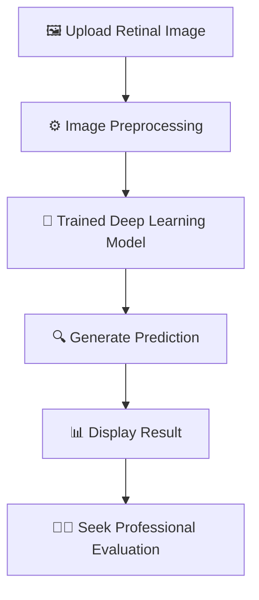

# 👁️ Eye-For-an-Eye
### AI-Powered Diabetic Retinopathy Detection

<p align="center">
  <strong>👁️ Detect Early. Protect Vision. Make a Difference.</strong>
</p>

<p align="center">
  An AI-powered web application designed to analyze retinal fundus images and support the identification of diabetic retinopathy using deep learning.
</p>

<p align="center">
  
  
  
  
</p>

---

## 🌟 About the Project

**Eye-For-an-Eye** is a deep-learning-based project focused on diabetic retinopathy (DR), an eye complication associated with diabetes that can damage the retina and affect vision.

The application provides a simple interface for uploading a retinal fundus image and obtaining a model-generated prediction. It combines deep learning with a web interface to demonstrate how AI can be applied to medical image analysis.

🎯 **Project goal:** Explore how AI-based image classification can support research into diabetic retinopathy detection and encourage awareness of early eye screening.

## ✨ Key Features

- 🖼️ **Retinal Image Input** — Work with retinal fundus images through a web interface.
- 🧠 **Deep Learning Prediction** — Use a trained PyTorch model to generate predictions.
- 🌐 **Interactive Web Application** — Access the application through a Streamlit interface.
- ⚙️ **Model Integration** — Load trained model weights for inference.
- 🚀 **Web Deployment** — Designed to run locally and be deployed as a web application.

## 🔄 How It Works



1. **Upload:** Provide a retinal fundus image.
2. **Preprocess:** Prepare the image in the format expected by the model.
3. **Predict:** Pass the processed image to the trained model.
4. **Display:** View the prediction returned by the application.
5. **Follow up:** Consult a qualified eye-care professional for medical assessment.

## 🛠️ Tech Stack

| Technology | Purpose |
|---|---|
| Python | Core programming language |
| PyTorch | Deep learning and model inference |
| Streamlit | Interactive web application |
| Pillow (PIL) | Image handling |
| Git & GitHub | Version control and project hosting |

## 📸 Application Preview

Add screenshots of your actual application here so visitors can see how it works.

<p align="center">
  <em>Application home screen</em>
</p>

<!-- Add a screenshot named app-home.png inside the assets folder -->
<p align="center">
  
</p>

<p align="center">
  <em>Prediction results</em>
</p>

<!-- Add a screenshot named prediction-result.png inside the assets folder -->
<p align="center">
  
</p>

## 📂 Project Structure

```text
Eye-For-an-Eye/
│
├── .github/
│   └── copilot-instructions.md
├── outputs/
│   └── best_model.pt
├── .gitignore
├── BlindnessDetection.py
├── app.py
├── requirements.txt
└── README.md
```

*Note: The structure above reflects the main project files; the contents of `outputs/` may vary.*

## 🚀 Getting Started

### Prerequisites

- Python installed
- Git installed
- A compatible environment for PyTorch

### 1. Clone the repository

```bash
git clone https://github.com/AwantikaAnkushe/Eye-For-an-Eye.git
cd Eye-For-an-Eye
```

### 2. Create and activate a virtual environment

**Windows PowerShell**

```powershell
python -m venv .venv
.\.venv\Scripts\Activate.ps1
```

### 3. Install dependencies

```bash
pip install -r requirements.txt
```

### 4. Run the application

```bash
streamlit run app.py
```

Streamlit will provide a local URL in the terminal. Open it in your browser to use the application.

## 🧪 Model Information

The project includes trained model weights in `outputs/best_model.pt`.

The model architecture, input dimensions, preprocessing steps, supported classes, and evaluation metrics should be documented here once verified against the implementation and test results.

## 🔮 Future Improvements

- 📚 Expand the range of retinal conditions covered by the project.
- 🧪 Evaluate the model using appropriate validation and test datasets.
- 📈 Report metrics such as precision, recall, F1-score, and a confusion matrix.
- 🖥️ Improve the user interface and prediction explanations.
- ☁️ Improve deployment reliability and model-loading performance.

## ⚠️ Medical Disclaimer

**Eye-For-an-Eye is an educational and research project, not a medical diagnostic tool.** Its predictions may be incorrect and must not be used as a substitute for professional examination, diagnosis, or treatment. Anyone with concerns about their vision or eye health should consult a qualified eye-care professional.

## 👩‍💻 Author

**Awantika Ankushe**

- GitHub: [@AwantikaAnkushe](https://github.com/AwantikaAnkushe)
- Project Repository: [Eye-For-an-Eye](https://github.com/AwantikaAnkushe/Eye-For-an-Eye)

---

<p align="center">
  💜 <strong>Building technology with the potential to make a difference.</strong>
  <br/>
  <em>Eye-For-an-Eye — Explore AI. Support eye-health research.</em>
</p>
